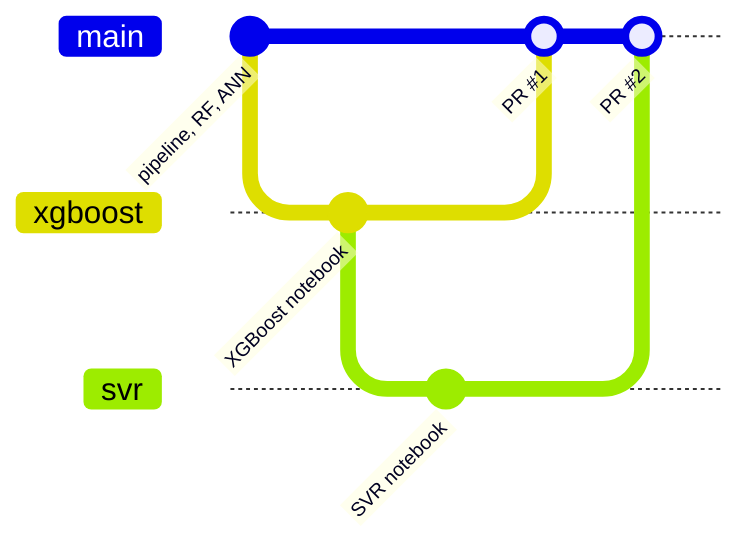

# Icare-ML: XGBoost & SVR Methods and GitHub Workflow

Oct 26, 2026 · @Suryavadhani

## Overview

XGBoost and SVR both predict Goldmann (GAT) IOP from an iCare reading and central corneal thickness (CCT). XGBoost is the better of the two (test MAE 2.901 vs 2.912 mmHg), and neither improves much on a straight line.

- **Repository:** `abhay04now/Icare-ML` on GitHub.
- **Data:** one row per eye: `date | euid | icare_iop | cct | applanation_iop`. Left and right eyes are separate rows; `euid` is `L` or `R` + the patient ID.
- **Splits:** made once by `src/split_dataset.py`, by patient, about 70 / 15 / 15: 4,648 train, 1,001 validation and 990 test eyes. No patient appears in two splits.
- **Notebooks:** `random_forest.ipynb`, `02_ann.ipynb`, `03_xgboost.ipynb`, `04_svr.ipynb`. Every notebook reads the same three CSVs from `data/splits/`.

## Shared method (both notebooks)

Both models were built under the same rules, so their numbers can be compared directly.

1. **Features and target.** Inputs `icare_iop` and `cct`; target `applanation_iop`. Nothing else goes into the model.
2. **Patient groups.** The patient ID is cut from the EUID (`L00220` → `00220`). It is never a feature; it only keeps both eyes of a patient in the same cross-validation fold.
3. **Baselines first.** Three references set the bar any model must beat:
   - Identity: GAT = iCare (validation MAE 2.996).
   - Straight line on iCare: GAT = 3.39 + 0.85 × iCare (2.883).
   - Straight line on iCare + CCT (2.892).
4. **Metrics.** MAE in mmHg (the headline), RMSE, and R², via one shared `evaluate()` helper.
5. **Tuning.** One-at-a-time sweeps scored on the validation set, then a randomised search scored by 5-fold `GroupKFold` on patient ID. Plain `KFold` would put a patient's left eye in training and right eye in the held-out fold, which flatters the score.
6. **Checks on the chosen model.** Training-vs-validation gap, residual plots, actual-vs-predicted plot, Bland–Altman limits of agreement, error by IOP band (<10, 10–20, 20–30, 30–40, 40+), permutation importance, and a CCT ablation (refit on iCare alone).
7. **Test once.** The test set is scored a single time, after every choice is made, and never used to pick anything.

## XGBoost (`notebooks/03_xgboost.ipynb`)

The tuned XGBoost is small and heavily regularised (depth-3 trees, learning rate 0.01, `reg_lambda=10`), because extra capacity only fitted noise.

XGBoost builds shallow decision trees one after another; each new tree corrects the errors the earlier trees left.

| Step | What was done | Result (validation MAE, mmHg) |
| --- | --- | --- |
| 1. Defaults | `XGBRegressor()` out of the box | 3.118: worse than identity; train 2.242, so it memorised patients |
| 2. Learning rate | Rates 0.3 to 0.01, depth 3, 5,000-tree budget, early stopping after 100 rounds without improvement | 2.800–2.811 at every rate; only the tree count changes (16 to 654) |
| 3. Learning curve | Train and validation MAE per round at rate 0.03 | Curves overlap and flatten near round 100: no overfitting, no capacity left |
| 4. Tree depth | Depths 1–10 | Best at 2–3 (2.802); 3.053 at depth 10 |
| 5. `min_child_weight` | 1 to 100 | Flat: 2.803–2.829 |
| 6. Randomised search | 100 configurations over 9 settings, `GroupKFold(5)` on patient | CV MAE 2.838, validation 2.809 |

**Final model:** `max_depth=3`, `n_estimators=500`, `learning_rate=0.01`, `min_child_weight=5`, `subsample=0.6`, `colsample_bytree=1.0`, `reg_lambda=10`, `reg_alpha=0`. Train MAE 2.787 vs validation 2.809 (gap 0.022).

**Test result:** MAE 2.901, RMSE 3.986, R² 0.730; Bland–Altman bias +0.37 mmHg, limits −7.41 to +8.16; 47% of eyes within ±2 mmHg, 86% within ±5.

**What it showed:**

- CCT adds nothing: shuffling it raises MAE by 0.007 (iCare: 3.42), and dropping it slightly improves the model.
- Above 30 mmHg the model is worse than the raw iCare reading and under-predicts, because 93% of training eyes are below 30.
- Saved: `models/xgboost_iop.json`, `results/metrics/model_comparison.csv`, `results/metrics/xgboost_error_by_iop_range.csv`.

## SVR (`notebooks/04_svr.ipynb`)

The tuned SVR is an RBF kernel on standardised inputs with `C≈15`, `gamma≈0.18`, `epsilon=0.25`. It matches the trees overall, but its curve bends the wrong way at very high pressure.

SVR fits one smooth curve and ignores errors smaller than `epsilon`; larger errors cost in proportion to their size, which is close to how MAE scores them.

| Step | What was done | Result (validation MAE, mmHg) |
| --- | --- | --- |
| 1. Scaling | Default SVR on raw vs standardised inputs | Raw 3.870 (worse than identity); standardised 2.855. All later models use `StandardScaler → SVR` in one pipeline |
| 2. Kernel | Linear, poly degree 2 and 3, RBF | Linear 2.856, RBF 2.855; poly 4.26 / 3.78 only because default `coef0=0` removes the straight-line term |
| 3. `C` | 0.01 to 1,000 | Flat from 1 to 100 (2.849–2.866); 3.751 at C=0.01 |
| 4. `epsilon` | 0 to 3 mmHg | Flat (2.851–2.871); support vectors fall from 4,648 to 1,671 |
| 5. Randomised search | 60 configurations of `C`, `gamma` (log-scale) and `epsilon`, `GroupKFold(5)` on patient | CV MAE 2.797, validation 2.829 |

**Final model:** RBF, `C=15.41`, `gamma=0.1758`, `epsilon=0.25`; 4,359 support vectors of 4,648. Train MAE 2.772 vs validation 2.829 (gap 0.058).

**Test result:** MAE 2.912, RMSE 4.084, R² 0.717; Bland–Altman bias +0.83 mmHg, limits −7.02 to +8.67; 48.6% of eyes within ±2 mmHg, 82.9% within ±5.

**What it showed:**

- **Best model in the 10–20 mmHg band** (MAE 1.97 vs XGBoost 2.09), but worse than XGBoost from 20 to 40 mmHg and worse than raw iCare at 20–30.
- **Above about 58 mmHg iCare the curve turns down:** higher readings give lower predictions. Only 85 training eyes are above 40, so the RBF fit drifts back toward the average. That rules it out clinically without a fix.
- **Loss function alone helps a straight line:** linear-kernel SVR scores 2.856 vs 2.883 for least squares.
- CCT again adds nothing (shuffling it: +0.001 MAE; iCare: +3.46).
- Saved: `models/svr_iop.joblib` (not in git, because `models/` is ignored), an SVR row in `results/metrics/model_comparison.csv`, and `results/metrics/svr_error_by_iop_range.csv`.

## Results compared

XGBoost is the best model on every test metric, but all four model families sit within 0.04 mmHg of each other on validation. The limit is the two inputs, not the algorithm.

| Model | Val MAE (mmHg) | Test MAE (mmHg) | Test RMSE (mmHg) | Test R² |
| --- | --- | --- | --- | --- |
| XGBoost (tuned) | 2.809 | 2.901 | 3.986 | 0.730 |
| SVR (RBF, tuned) | 2.829 | 2.912 | 4.084 | 0.717 |
| Random Forest (depth 4) | 2.806 | 2.920 | 4.000 | 0.728 |
| Linear (iCare + CCT) | 2.892 | 3.002 | 4.113 | 0.713 |
| Linear (iCare only) | 2.883 | 3.005 | 4.114 | 0.712 |
| Identity (GAT = iCare) | 2.996 | 3.214 | 4.352 | 0.678 |
| ANN 2-32-16-1 | 2.847 | not run | not run | not run |

Source: `results/metrics/model_comparison.csv`, sorted by test MAE. Error by IOP band (validation MAE):

| IOP band | Eyes | XGBoost | SVR | Identity |
| --- | --- | --- | --- | --- |
| <10 | 15 | 3.73 | 3.26 | 1.00 |
| 10–20 | 641 | 2.09 | 1.97 | 2.46 |
| 20–30 | 267 | 3.11 | 3.40 | 3.30 |
| 30–40 | 55 | 6.76 | 7.25 | 5.91 |
| 40+ | 23 | 9.24 | 9.26 | 8.78 |

The best tuned model beats a straight line by only about 0.1 mmHg on test, which is inside the 1–2 mmHg variability of GAT itself.

## Using GitHub after you get results

Each new model or experiment gets its own branch. Its results are committed with the notebook, and it reaches `main` through a pull request (PR) that a teammate can review.

The repo `abhay04now/Icare-ML` is **private**. PR #1 (XGBoost) and PR #2 (SVR) were merged into `main` on 26 Oct 2026.

### How the XGBoost and SVR branches were merged



`svr` was branched from `xgboost`, so `xgboost` was merged first. That left the SVR pull request with only its own commit.

### The loop for every new piece of work

1. **Start from an up-to-date `main`:**

   ```bash
   git switch main
   git pull
   git switch -c <short-name>      # e.g. wider-cct, ann-test
   ```

2. **Do the work and run the notebook end to end** so the saved outputs match the code (Kernel → Restart & Run All, or `jupyter nbconvert --to notebook --execute --inplace notebooks/<name>.ipynb`).
3. **Check what changed before committing:**

   ```bash
   git status
   git diff results/metrics/      # sanity-check the numbers you are about to commit
   ```

4. **Commit the right files:** the notebook (with outputs), `src/` scripts, and `results/metrics/*.csv`. Leave out what `.gitignore` already excludes: `models/`, `.venv/`, `data/raw/`, `data/cleaned/`.

   ```bash
   git add notebooks/<name>.ipynb results/metrics/
   git commit -m "<Model>: test MAE x.xxx mmHg"
   ```

5. **Push the branch:** `git push -u origin <short-name>` (after the first push, plain `git push`).
6. **Open a PR into `main`** on GitHub, or `gh pr create --base main`. In the description, put the headline numbers, what changed, and anything surprising (for SVR: the downturn above 58 mmHg).
7. **Review and merge.** A teammate reads the notebook diff and the metrics, then clicks **Merge** on GitHub.
8. **Clean up after the merge:**

   ```bash
   git switch main
   git pull
   git branch -d <short-name>
   ```

### Stacked branches

If you branch from another unmerged branch (as `svr` was from `xgboost`), merge the lower branch first. Otherwise the upper PR carries both sets of commits.

### Things that commonly go wrong

- **Two branches edit `results/metrics/model_comparison.csv`.** The second merge may conflict. Fix it by keeping every model's row, or re-run the notebook on the updated `main` so it rewrites the file.
- **Notebook conflicts are hard to read.** Avoid two people editing the same `.ipynb` on different branches; give each model its own notebook, as now.
- **Pulling a teammate's work:** `git fetch` then `git switch <their-branch>` to look at it, or `git pull` on `main` after they merge.
- **Committing secrets or raw data.** Run `git status` before every commit; `git add .` can pick up files you did not mean to share.
- **Marking a result you may cite later:** tag the commit, e.g. `git tag svr-v1 && git push origin svr-v1`, so the exact code behind a number can be recovered.

## Reproducing and next steps

Both notebooks rerun to the same numbers: every random step uses `random_state=42`, and the SVR notebook was run twice with identical results.

```bash
cd Icare-ML
git switch main
cd notebooks
../.venv/bin/jupyter nbconvert --to notebook --execute --inplace 03_xgboost.ipynb
../.venv/bin/jupyter nbconvert --to notebook --execute --inplace 04_svr.ipynb       # about 1 minute
```

Run `03_xgboost` before `04_svr`: the SVR notebook reads the comparison table and the XGBoost band errors that `03` writes.

**Next steps, in order of value:**

- [ ] Widen or remove the 480–580 µm CCT filter in `src/clean_ranges.py` and repeat the CCT ablation. This tests whether the filter is hiding CCT's effect.
- [ ] Keep repeat measurements per eye (`remove_repeated_euid.py` drops about 36% of rows) to add high-pressure examples.
- [ ] Fix high-pressure under-prediction: sample weights, a log target, or XGBoost `monotone_constraints`.
- [ ] Score the ANN once on the test set so it can join the comparison table.
- [ ] Add a linear-kernel SVR as a readable baseline (GAT = a + b × iCare, fitted with the SVR loss).
- [x] Merge `xgboost`, then `svr`, into `main`.
